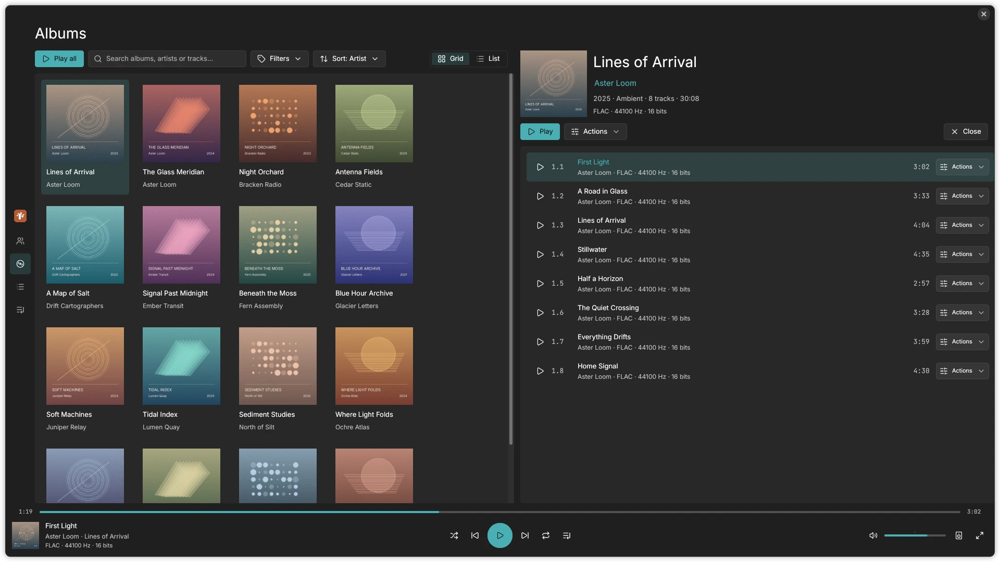

# Soliton

  

Soliton is a native [Rust](https://www.rust-lang.org/) and [GPUI](https://github.com/zed-industries/zed/tree/main/crates/gpui) player for local music libraries. Add your music folders in Settings, then browse and play the albums and tracks Soliton indexes.

## Platforms

- **Windows** 10 (1809) and later, x64: per-user installer.
- **Linux** x86_64: RPM for Fedora 44 and later, .deb for Ubuntu 24.04, Linux Mint 22, and Debian 13 and later, Flatpak for other distributions, and a per-user archive. See the [Linux guide](docs/LINUX.md) for installation and building.

Linux requires PipeWire for audio.

## Your Music, Kept Local

Browse music from multiple folders, external drives, or mounted network shares in one library. Soliton reads metadata and artwork from your files and stores its database and caches separately. **Your music files, tags, and embedded artwork remain untouched.**

Background indexing and filesystem monitoring keep the library up to date. When a source goes offline, its albums stay in your library and are marked unavailable until it returns.

## Key Features

- **Album and Artist Browsing**: Explore grid or list views, open album details, and browse compilations under Various Artists.
- **Multiple Editions**: Group matching album editions and put the best available edition first.
- **Search and Filters**: Search regardless of case or accents. Filter by genre, period, artist, format, or quality, and sort by artist, title, year, or recent additions.
- **Playback and Queue**: Use a persistent player bar, Now Playing, fullscreen mode, shuffle, repeat, manual playlists, and an editable queue.
- **Local and Network Outputs**: Choose a local audio device (Bluetooth included), or play to DLNA / UPnP and Google Cast receivers.
- **Desktop Integration**: On Windows, use media keys, system media controls, taskbar thumbnail controls, and the notification area, and configure closing behavior and automatic startup. On Linux, use media keys and the desktop media panel through MPRIS.
- **Personalization**: Choose English or French, system/light/dark appearance, accent color, artwork size, and the application icon (on Linux, for archive installations only).

Tested formats include **WAV, FLAC, MP3, AAC-LC/M4A, ALAC, Vorbis, and AIFF**.

## Keyboard Shortcuts

| Action | Shortcut |
| --- | --- |
| Search | Ctrl + F |
| Play / Pause | Space |
| Previous / next track | Ctrl + Left / Right |
| Seek backward / forward 10 seconds | Ctrl + Shift + Left / Right |
| Adjust volume | Ctrl + Up / Down |
| Navigate history | Alt + Left / Right |
| Full screen listening view | F11 |
| Go back | Escape |

The full list is under **Keyboard shortcuts** in Settings.

## Documentation

See the [development guide](docs/DEVELOPMENT.md#run) to build from source and the
[documentation index](docs/README.md) for architecture, distribution and product decisions.

## License

Soliton is licensed under the **GNU GPL v3 (GPL-3.0-only)**. See [LICENSE](LICENSE) for details, [asset attributions](assets/NOTICE.md), and [dependency license notices](licenses/dependencies/README.md).
