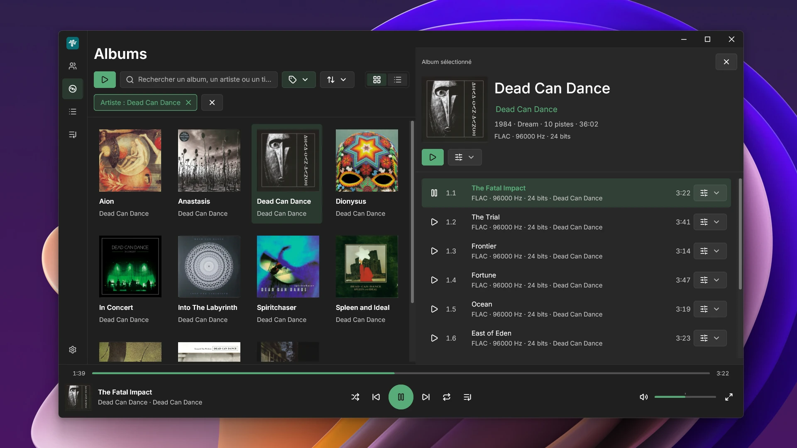

# Soliton

<p align="center">
  
</p>

Soliton is a native audio library player built in **Rust** with **GPUI**. It indexes your local music collection and presents it in a responsive desktop interface, with rich metadata, album artwork, multiple editions, and playback on local or network devices.

Soliton plays the albums and tracks of its library: add your music folders as sources, and everything is browsed and played from there. It is not a standalone file player: files opened from a file manager or dropped onto the window are not played directly.

## Platforms

- **Windows** 10 (1809) and later, x64: per-user installer.
- **Linux** x86_64: RPM for Fedora 44 and later, .deb for Ubuntu 24.04, Linux Mint 22, and Debian 13 and later, Flatpak for other distributions, and a per-user archive. See the [Linux guide](docs/LINUX.md) for installation and building.

On Linux, Soliton plays through a native PipeWire stream (PulseAudio alone is not supported), follows the system default output or a chosen PipeWire output (Bluetooth headsets included), and integrates with the desktop media panel and media keys through MPRIS. Install new releases through your package manager, Flatpak, or a newer archive.

## Your Music, Kept Local

Browse music from multiple folders, external drives, or mounted network shares in one library. Soliton reads metadata and artwork from your files and stores its database and caches separately. **Your music files, tags, and embedded artwork remain untouched.**

Background indexing and filesystem monitoring keep the library up to date. When a source goes offline, its albums stay in your library and are marked unavailable until it returns.

## Key Features

- **Album and Artist Browsing**: Explore grid or list views, open album details, and browse compilations under Various Artists.
- **Multiple Editions**: Group matching album editions and put the best available edition first.
- **Search and Filters**: Search regardless of case or accents. Filter by genre, period, artist, format, or quality, and sort by artist, title, year, or recent additions.
- **Playback and Queue**: Use a persistent player bar, Now Playing, fullscreen mode, shuffle, repeat, manual playlists, and an editable queue.
- **Local and Network Outputs**: Choose a local audio device (Bluetooth included), or play to DLNA / UPnP and Google Cast receivers.
- **Desktop Integration**: On Windows, use media keys, system media controls, taskbar thumbnail controls, and the notification area, and configure closing behavior and automatic startup. On Linux, use media keys and the desktop media panel through MPRIS.
- **Personalization**: Choose English or French, system/light/dark appearance, accent color, artwork size, and the application icon (on Linux, for archive installations only).

Tested formats include **WAV, FLAC, MP3, AAC-LC/M4A, ALAC, Vorbis, and AIFF**.

## Technology Stack

- **Application and UI**: Rust and [GPUI](https://github.com/zed-industries/zed/tree/main/crates/gpui), with native GPU-accelerated rendering.
- **Audio**: Symphonia for decoding, an audio engine independent of the interface, and native local output: WASAPI through CPAL on Windows, PipeWire on Linux.
- **Library**: SQLite through rusqlite, Lofty for tags and artwork, and background indexing with cancellation and bounded concurrency.
- **System Integration**: Dedicated platform interfaces with Windows and Linux (MPRIS, XDG portals, inotify) implementations.
- **Icons**: Official [Lucide](https://lucide.dev/) SVG assets.

## Getting Started

### Prerequisites

The current validation baseline is Rust 1.98.1.

- **Windows**: Rust with the MSVC x64 toolchain, and Visual Studio Build Tools with the Visual C++ build tools and Windows SDK.
- **Linux**: a C/C++ toolchain, CMake, pkg-config, Clang, and the PipeWire, xkbcommon, FreeType, Fontconfig, XCB, and Wayland development packages; running requires Vulkan and a Wayland or X11 session. The [Linux guide](docs/LINUX.md#préparer-fedora-pour-le-développement) gives the Fedora command.

### Build and Run

From the repository root:

```sh
cargo run -p soliton-app --bin Soliton
```

For release builds, Windows packaging, and update behavior, see the [distribution guide](docs/DISTRIBUTION.md); Linux packages are covered in the [Linux guide](docs/LINUX.md). Development checks, smoke tests, and hardware probes are documented in the [development guide](docs/DEVELOPMENT.md).

## Keyboard Shortcuts

| Action | Shortcut |
| --- | --- |
| Search | Ctrl + F |
| Play / Pause | Space |
| Seek backward / forward 10 seconds | Ctrl + Left / Right |
| Adjust volume | Ctrl + Up / Down |
| Navigate history | Alt + Left / Right |
| Full screen listening view | F11 |
| Go back | Escape |
| Navigate / activate controls | Tab / Enter |

## Documentation

See the [documentation index](docs/README.md) for development and validation details, architecture, dependencies, distribution, and product specifications.

## License

Soliton is licensed under the **GNU GPL v3 (GPL-3.0-only)**. See [LICENSE](LICENSE) for details, [asset attributions](assets/NOTICE.md), and [dependency license notices](licenses/dependencies/README.md).
